<p align="center"></p>

<h1 align="center">SideDrop</h1>

<p align="center"><b>Share your Apple developer account and help your friends sideload apps.</b><br>
A password-protected site you run yourself: friends register their iPhone once, and every app on it is signed for them
with your certificate, ready to install from Safari.</p>

<div align="center">


</div>

<p align="center">
  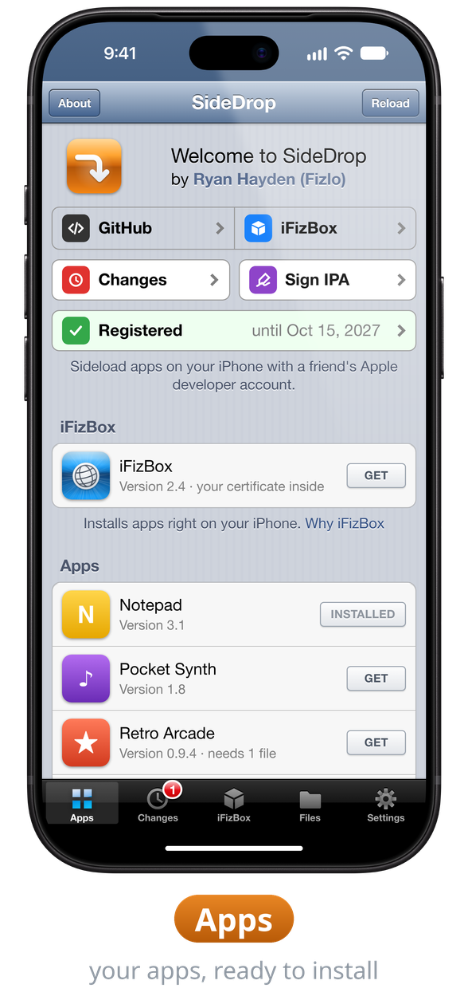
  
  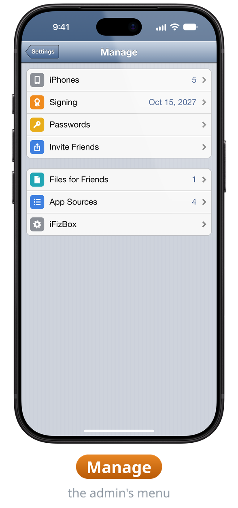
</p>

> [!NOTE]
> SideDrop uses **ad hoc** signing, which Apple allows for up to 100 iPhones per developer account and year. It does
> not get around that limit, and everyone who installs iFizBox from it can pull your certificate out of the app: share
> it with people you trust. See [Limits](#limits).

## Contents

- [What it is](#what-it-is)
- [Screenshots](#screenshots)
- [Quick start](#quick-start)
- [What the admin can do](#what-the-admin-can-do)
- [Configuration](#configuration)
- [Apps, sources and files](#apps-sources-and-files)
- [Limits](#limits)
- [Development](#development)
- [License](#license)

## What it is

You have an Apple developer account; your friends don't. SideDrop puts the account behind one web page, so friends
can install the apps you share on their own iPhones without a computer, a cable or a certificate of their own.

1. A friend opens the site in Safari, types the password (or opens an [invite link](#what-the-admin-can-do)), turns
   off Stolen Device Protection (the page walks through it with screenshots) and taps **Register iPhone**. They
   install the small profile it downloads.
2. iOS sends the server the phone's UDID. SideDrop registers the device with Apple through the App Store Connect API,
   regenerates the ad hoc profile and re-signs every app.
3. Safari comes back to the site, where every app now has an **Install** button.

That's once per iPhone. After that:

- **Apps** lists your apps and, under **Third-party apps**, other people's, mirrored from AltStore sources. An app can
  bring files with it (a game pack, say), listed under its Install button.
- **Changes** lists apps by release date, Cydia style. Installs are remembered per phone, so new versions of what a
  friend installed show under **Available Updates**, with a badge on the tab, an **Update** button and, from the Home
  Screen app, a web push notification.
- **Sign IPA** (on Settings): drop any IPA or paste a link, get an install link signed for every registered phone.
- **iFizBox** installs [iFizBox](https://ifizbox.com), a package manager that signs apps on the phone, with your
  certificate and your sources already inside it.
- **Files** shows files the admin shared with everyone.

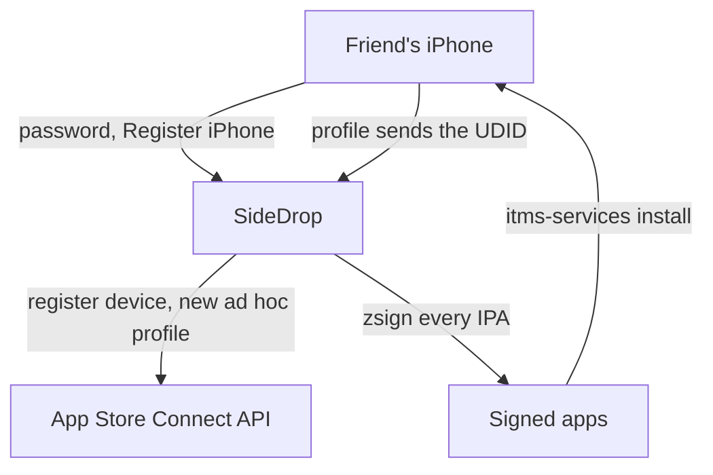
<!-- Experimental: if rendering fails, preview on GitHub -->

## Screenshots

What a friend sees: a local run with demo data (made-up apps, iPhones and account; nothing from a real server) at the
iPhone 18 Pro's screen size, framed in its bezel. [`docs/readme_shots.py`](docs/readme_shots.py) makes them again.

<p align="center">
  
  
  
  
</p>

## Quick start

You need an Apple Developer Program membership, a machine with Docker that stays on, and HTTPS with a real
certificate (a domain behind a reverse proxy, a Cloudflare Tunnel or `tailscale funnel 8080`): iOS won't install
profiles or apps over plain HTTP or a self-signed certificate.

> [!TIP]
> New to all this? [docs/become-a-distributor.md](docs/become-a-distributor.md) goes from the Apple account through
> Docker Compose and HTTPS to the setup screen, step by step.

**1. Make an App Store Connect API key.** In App Store Connect → Users and Access → Integrations → Keys, make one key
with the **Admin** role and download `AuthKey_<Key ID>.p8`. Note the Issuer ID above the list. SideDrop makes the
certificate and the App ID with it ([docs/developer-account.md](docs/developer-account.md) has the details, and a
**Manual setup** for a key that can't make certificates).

**2. Start the server.**

```bash
git clone https://github.com/RyanAHayden/sidedrop.git && cd sidedrop
cp .env.example .env            # set PUBLIC_URL=https://<your domain>; the rest can stay empty
mkdir -p data && sudo chown 568:568 data
SIDEDROP_COMMIT=$(git rev-parse --short HEAD) docker compose up -d --build
```

It listens on port 8080 and keeps everything in `./data`, which must be owned by UID 568.

**3. Finish on your iPhone.** Open the site and sign in with the default password, **`sidedrop`**; it opens only the
setup screen. Set the two passwords, tap **Choose API Key** and pick the `.p8` (the Key ID comes from its name), fill
in the Issuer ID and an App ID, and **Save**. SideDrop makes the App ID and an Apple Distribution certificate, and the
default password stops working.

<p align="center">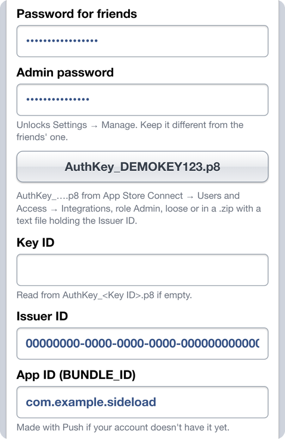</p>

**4. Register your own iPhone first**, then send friends the link and the password, or an invite link from Manage.
Put IPAs in `data/apps/` or list AltStore sources (see [Apps, sources and files](#apps-sources-and-files)).

## What the admin can do

Sign in with the admin password instead of the friends' one and **Settings → Manage** appears. Friends never see it.

<p align="center">
  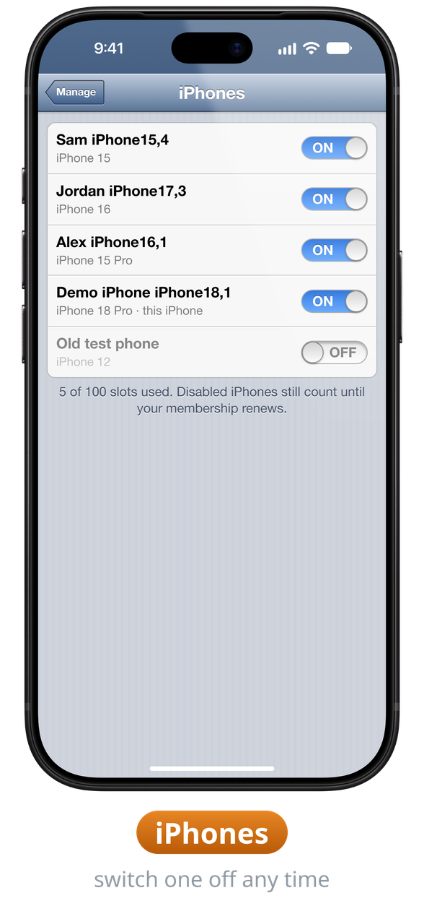
  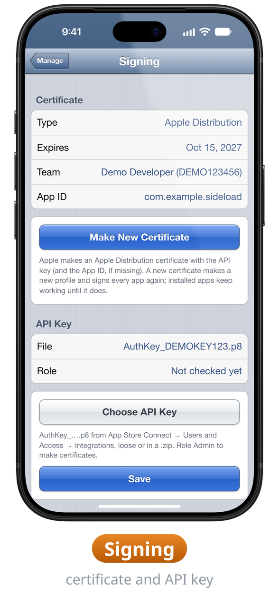
  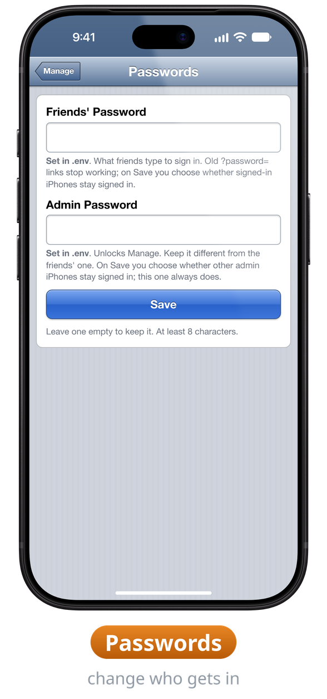
</p>
<p align="center">
  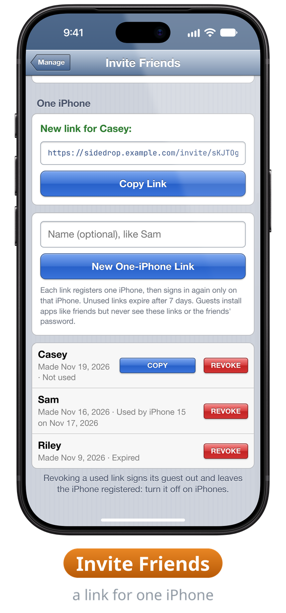
  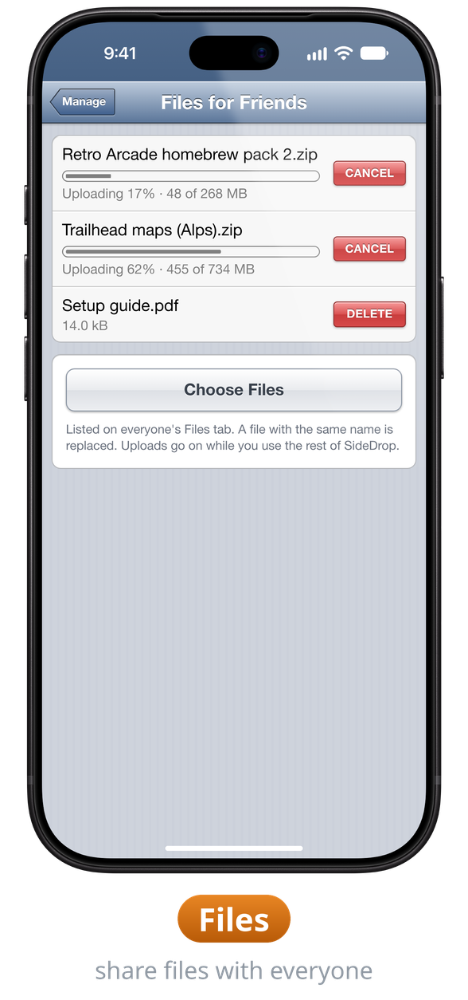
  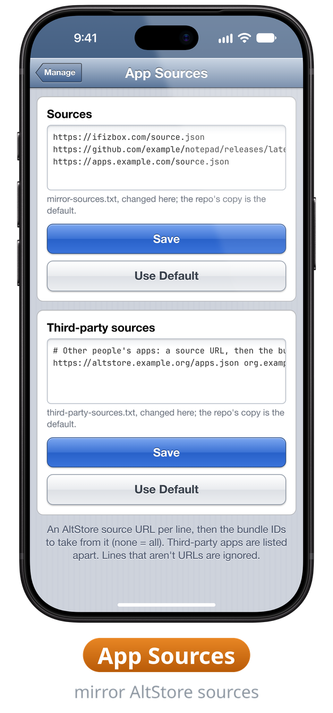
</p>

**iFizBox** edits the sources and settings iFizBox starts with, and Manage warns at the top when the certificate is
about to expire or can't sign. The details are in [docs/configuration.md](docs/configuration.md#manage-in-more-detail).

## Configuration

`.env` needs only `PUBLIC_URL`. The setup screen sets the rest, and **Manage → Signing** changes it later. Anything
you do put in `.env` (passwords, API key IDs, `BUNDLE_ID`) wins over both.

Use an explicit App ID such as `com.you.sideload`: apps keep their own bundle IDs and push works.

<p align="center">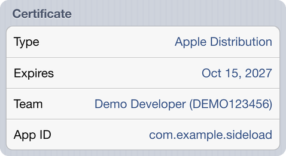</p>

Every variable, wildcard App IDs, the data folder and setting up without an iPhone:
[docs/configuration.md](docs/configuration.md).

## Apps, sources and files

- **Your IPAs**: drop them in `data/apps/`; they're signed on the next page load.
- **AltStore sources**: one URL per line on **Manage → App Sources** (or `mirror-sources.txt`); new versions are
  signed within the hour. Other people's apps go under **Third-party sources**, with the bundle IDs to take.
- **Files**: beside an app in `data/appfiles/<ipa name>/`, or for everyone on **Manage → Files for Friends**.

<p align="center">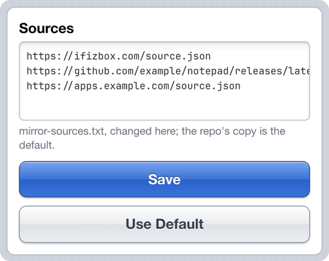</p>

Editing the lists on GitHub, `deploy.sh`, and having CI sign new releases right away (`POST /sync`):
[docs/configuration.md](docs/configuration.md#apps-sources-and-files).

## Limits

- **100 iPhones** per developer account per membership year. Disabling a device only frees its slot at renewal.
- **One year**: ad hoc apps stop launching when the distribution certificate expires. Make a new one on Manage →
  Signing and everything is signed again.
- **Developer Mode** must be on, once per phone (iOS 16 and later; only App Store, TestFlight and enterprise apps are
  exempt). The page explains how.
- **Speed** is capped by your server's upload bandwidth. Cloudflare's free plan won't cache files this large.
- **Your certificate is shared**: anyone who installs iFizBox from your site can extract it.

The name people see is SideDrop. The lowercase `sidedrop` stays wherever a deployment or an installed iPhone depends
on it: the repo, the Docker image and TrueNAS app, the `SIDEDROP_*` variables, the profile identifier
`sidedrop.udid`, the ad hoc profile name (`PROFILE_NAME`) and the default password.

## Development

One Flask app (`app.py`, pages included) served by gunicorn, with zsign in the Docker image for signing.

```bash
uv run -q --no-project --with-requirements requirements.txt python test_app.py
```

The tests stub App Store Connect and zsign and need no network. The README's screenshots (needs Apple's iOS 27 UI
Kit for the bezel, read from `~/repos/iFizBox/ref/apple-ios27/` or `--kit PATH`, never committed; `--plain` for
rounded screens without it):

```bash
uv run -q --no-project --with-requirements requirements.txt --with playwright --with pillow python docs/readme_shots.py
```

| Path | What it is |
| --- | --- |
| `app.py` | the whole server: pages, signing, Apple's API, Manage |
| `test_app.py` | the test suite |
| `static/` | the walkthrough screenshots and nav art the pages use |
| `*-sources.txt` | source lists (see above) |
| `Dockerfile`, `compose.yaml`, `deploy.sh` | the image, Compose service and pull-deploy |
| `docs/` | [becoming a distributor](docs/become-a-distributor.md), [the developer account](docs/developer-account.md), [configuration](docs/configuration.md), README screenshots |

## License

[GPL-3.0-or-later](LICENSE). zsign, which the Docker image downloads, is under its own license.
