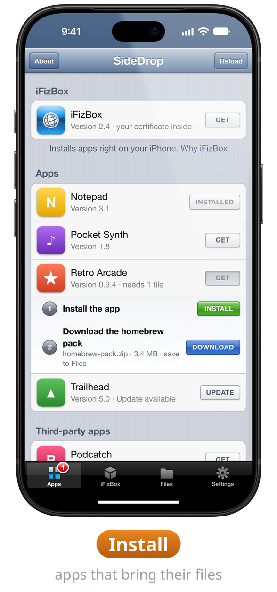
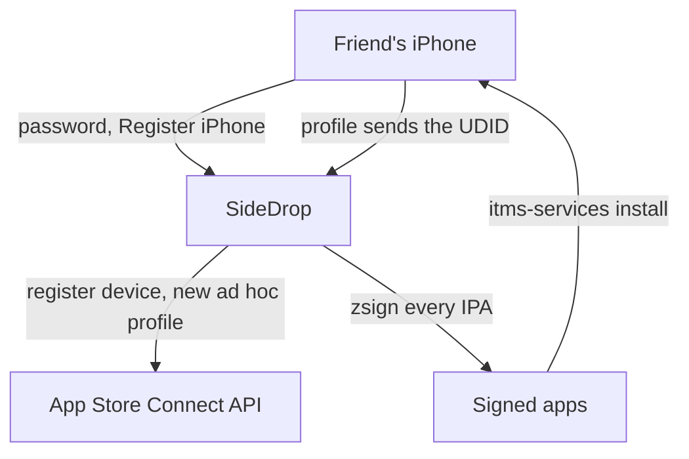
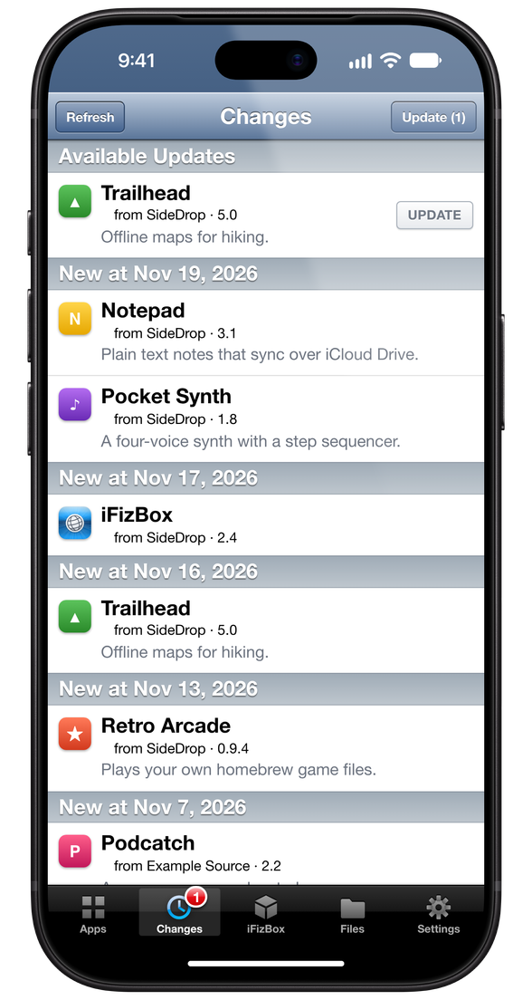
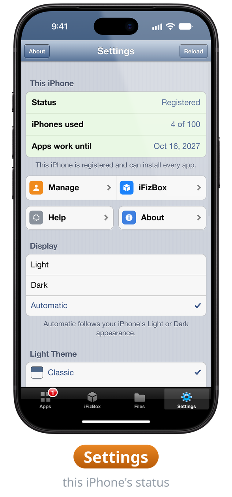
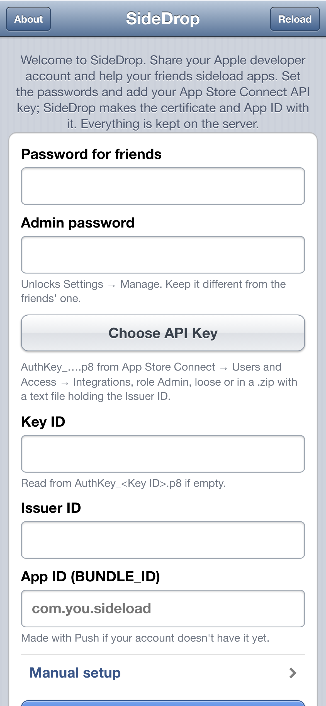

<p align="center"></p>

<h1 align="center">SideDrop</h1>

<p align="center"><b>Share your Apple developer account and help your friends sideload apps.</b><br>
A password-protected site you run yourself: friends register their iPhone once, and every app on it is signed for them
with your certificate, ready to install from Safari.</p>

<div align="center">


</div>

<p align="center">
  
  
  
</p>

> [!NOTE]
> SideDrop uses **ad hoc** signing, which Apple allows for up to 100 iPhones per developer account and year. It does
> not get around that limit, and everyone who installs iFizBox from it can pull your certificate out of the app: share
> it with people you trust. See [Limits](#limits).

## Contents

- [What it is](#what-it-is)
- [Screenshots](#screenshots)
- [Quick start](#quick-start)
- [What the admin can do](#what-the-admin-can-do)
- [Configuration](#configuration)
- [Apps, sources and files](#apps-sources-and-files)
- [Limits](#limits)
- [Development](#development)
- [License](#license)

## What it is

You have an Apple developer account; your friends don't. SideDrop puts the account behind one web page, so friends
can install the apps you share on their own iPhones without a computer, a cable or a certificate of their own.

1. A friend opens the site in Safari, types the password (or opens an [invite link](#what-the-admin-can-do)), turns
   off Stolen Device Protection (the page walks through it with screenshots) and taps **Register iPhone**. They
   install the small profile it downloads.
2. iOS sends the server the phone's UDID. SideDrop registers the device with Apple through the App Store Connect API,
   regenerates the ad hoc profile and re-signs every app.
3. Safari comes back to the site, where every app now has an **Install** button.

That's once per iPhone. After that:

- **Apps** lists your apps and, under **Third-party apps**, other people's, mirrored from AltStore sources. An app can
  bring files with it (a game pack, say), listed under its Install button.
- **Changes** lists apps by release date, Cydia style. Installs are remembered per phone, so new versions of what a
  friend installed show under **Available Updates**, with a badge on the tab, an **Update** button and, from the Home
  Screen app, a web push notification.
- **Sign IPA** (on Settings): drop any IPA or paste a link, get an install link signed for every registered phone.
- **iFizBox** installs [iFizBox](https://ifizbox.com), a package manager that signs apps on the phone, with your
  certificate and your sources already inside it.
- **Files** shows files the admin shared with everyone.


<!-- Experimental: if rendering fails, preview on GitHub -->

## Screenshots

A local run with demo data (made-up apps, iPhones and account; nothing from a real server) in headless Chromium at
390×844, the size of an iPhone 14. [`docs/readme_shots.py`](docs/readme_shots.py) makes them again.

| | | | |
|:-:|:-:|:-:|:-:|
|  |  |  |  |
| **Apps**: the registered iPhone's tile, iFizBox, your apps and their install state | **Changes**: new versions by date, with the update waiting for this phone on top | **An app install**: GET opens the steps of an app that needs a file | **Settings**: this iPhone's status, the slots used and when the apps stop working |
|  |  |  |  |
| **Manage**: the admin's menu, behind the admin password | **iPhones**: every device on the account, with a switch to take one out of the profile | **Signing**: the certificate, the App ID and the API key, and a new certificate in one tap | **The setup splash**: a new server's first sign-in sets the passwords and takes the API key |

## Quick start

You need an Apple Developer Program membership, a machine with Docker that stays on, and HTTPS with a real
certificate (a domain behind a reverse proxy, a Cloudflare Tunnel or `tailscale funnel 8080`): iOS won't install
profiles or apps over plain HTTP or a self-signed certificate.

> [!TIP]
> New to all this? [docs/become-a-distributor.md](docs/become-a-distributor.md) goes from the Apple account through
> Docker Compose and HTTPS to the setup screen, step by step.

**1. Make an App Store Connect API key.** Join the program, then in App Store Connect → Users and Access →
Integrations → Keys make one key with the **Admin** role and download `AuthKey_<Key ID>.p8`. Note the Issuer ID shown
above the list. That's all you make by hand: SideDrop makes the certificate and the App ID with it.
[docs/developer-account.md](docs/developer-account.md) has the details, and a **Manual setup** for a key that can't
make certificates.

**2. Start the server.**

```bash
git clone https://github.com/RyanAHayden/sidedrop.git && cd sidedrop
cp .env.example .env            # set PUBLIC_URL=https://<your domain>; the rest can stay empty
mkdir -p data && sudo chown 568:568 data
SIDEDROP_COMMIT=$(git rev-parse --short HEAD) docker compose up -d --build
```

It listens on port 8080. Everything it keeps lives in `./data` (or `DATA_DIR`), which must be owned by UID 568.

**3. Finish on your iPhone: the first-run splash.** Open the site. While no password is set, sign in with the default
password, **`sidedrop`**; it opens only the setup screen. There:

1. Set the password for friends and the admin password (saved hashed in `data/setup.json`).
2. Tap **Choose API Key** and pick the `.p8`, loose or in a `.zip` with a text file holding the Issuer ID. The Key ID
   is read from the file name and the Issuer ID from the text file; check them, and the App ID (`BUNDLE_ID`, e.g.
   `com.you.sideload`).
3. **Save**. SideDrop makes the App ID if the account lacks it (explicit, with Push, App Groups and Associated
   Domains), makes a private key and CSR, has Apple issue an Apple Distribution certificate and keeps `cert.p12` in
   the data folder. If the account already has the most certificates Apple allows, it lists them and you pick one to
   revoke; it never revokes one itself. The default password stops working.

**4. Register your own iPhone first**, then send friends the link and the password, or an invite link from Manage.
Put IPAs in `data/apps/` or list AltStore sources (see [Apps, sources and files](#apps-sources-and-files)).

<details>
<summary><b>Setting it up without an iPhone</b></summary>

Anything set in `.env` wins over the setup screen, and with `PASSWORD` set there is no setup screen. Put `asc.p8` and
`cert.p12` in the data folder and fill in `.env` (see [Configuration](#configuration)).

</details>

## What the admin can do

Sign in with the admin password instead of the friends' one (on the sign-in screen or as `?password=<admin password>`)
and **Settings → Manage** appears. Friends never see it.

| Page | What it does |
| --- | --- |
| **iPhones** | Lists the account's iPhones with when each was added and last used; disable or re-enable one. Apple has no API to delete a device: disabling takes it out of the profile so its apps stop opening, but its slot only frees up at renewal. |
| **Signing** | Shows the certificate, App ID and API key. Replace the key (**Choose API Key**), have Apple make a new certificate (**Make New Certificate**, with the same revoke list when the account is full), or upload your own under **Manual setup**. A new certificate gets a new profile and every app is signed again. |
| **Passwords** | Changes the friends' and the admin password. A change signs out every iPhone signed in with the old one, and old `?password=` links stop working. A password from `.env` can be overridden here too, until `.env` changes. |
| **Invite Friends** | **Anyone with the link** (`/join/<token>`) signs in without the password; **Make New Link** or a password change stops it. A **One iPhone** link (`/invite/<token>`, optional name, unused ones expire after 7 days) registers exactly one iPhone, so a shared link can't fill the account; the page lists each as Not used, Used by or Expired, with **Revoke**. |
| **Files for Friends** | Uploads files listed under **Files** on everyone's Apps tab, with signed links that work without a login (`wget`, `curl`) for 7 days. Uploads run in the background with a progress row each. |
| **App Sources** | Edits `mirror-sources.txt` and `third-party-sources.txt`. Edits are kept in `data/config/` and win over the repo's files; **Use Default** goes back. |
| **iFizBox** | Edits the sources iFizBox starts with and its settings (a JSON object it imports on first launch). |

Manage also warns at the top about the certificate: expiring within 30 days, revoked (Apple's OCSP), not in the API
key's account, the profile made for another certificate, or `BUNDLE_ID` missing or without Push. The setup screen and
Manage refuse a `cert.p12` that can't sign (wrong password, no private key, not Apple Distribution, or expired).

## Configuration

`.env` (copy `.env.example`). Only `PUBLIC_URL` is required; the setup screen covers the rest.

| Variable | What it is |
| --- | --- |
| `PUBLIC_URL` | The site's `https://` address, as iPhones reach it. |
| `PASSWORD` / `ADMIN_PASSWORD` | The friends' and the admin password. Set here, the setup screen is skipped. |
| `SECRET_KEY` | Signs sessions and links. Empty: made once and kept in `data/secret.key`. |
| `ASC_KEY_ID` / `ASC_ISSUER_ID` | The App Store Connect API key's IDs (the key itself is `data/asc.p8`). |
| `BUNDLE_ID` | The App ID every app is signed under (below). |
| `P12_PASSWORD` | The password of `data/cert.p12`, if you brought your own. |
| `SYNC_TOKEN` | Lets CI call `POST /sync` after a release ([below](#auto-updating-apps-from-github-releases)). |
| `PROFILE_CERT_DIR` | A folder with `fullchain.pem` and `privkey.pem`; the registration profile is then signed and iOS shows it as Verified. |

**`BUNDLE_ID`** is either an explicit App ID with Push Notifications, App Groups and Associated Domains, such as
`com.you.sideload` (recommended: apps keep their own bundle ID in Info.plist, so push works), or a wildcard such as
`com.you.*`, which re-IDs apps outside it (`com.other.game` becomes `com.you.game`) and can't carry entitlements like
push. Apps signed under a wildcard install again as separate apps after a switch.

The data folder:

```
asc.p8          App Store Connect API key (role Admin; App Manager on the manual path)
cert.p12        Apple Distribution certificate + private key, made by SideDrop or yours
apps/*.ipa      unsigned or dev-signed IPAs to share
appfiles/<app>/ files listed under that app's Install button (labels.txt: "file = label" per line)
files/          Files for Friends, uploaded on Manage
config/         Manage's edits of the source lists
```

`signed/`, `adhoc.mobileprovision`, `setup.json`, `secret.key` and the JSON state files are generated.

The grey version line at the bottom of Apps and Settings shows the commit the image was built from, when built with
`SIDEDROP_COMMIT=$(git rev-parse --short HEAD) docker compose up -d --build`.

## Apps, sources and files

- **Your IPAs**: drop them in `data/apps/`; they're signed on the next page load.
- **AltStore sources**: list source URLs in `mirror-sources.txt`; their apps are downloaded, signed and listed, and
  checked hourly and on page load (at most once a minute).
- **Other people's apps**: `third-party-sources.txt`, a source URL followed by the bundle IDs to take from it (none
  means all); listed under **Third-party apps**.
- **iFizBox**: `https://ifizbox.com/source.json` is in `mirror-sources.txt`. It's signed with your `cert.p12`, its
  password, the ad hoc profile and the sources in `ifizbox-sources.txt`, which it imports on first launch, so friends
  never pick a certificate or add a source.
- **App files**: files in `data/appfiles/<ipa name>/` show under that app's Install button, with signed links that
  last 7 days, work without a login and can be resumed.
- **Sign IPA**: a signed-in friend's own IPA, kept in `signed/custom/` for 7 days.

These repo files can be edited on github.com; a server running `deploy.sh` picks up changes within 5 minutes (edits
made on Manage win over them): `ifizbox-sources.txt`, `mirror-sources.txt`, `third-party-sources.txt`, and `app.py`
for everything else, including page text. `deploy.sh` is a pull-deploy for a TrueNAS custom app named `sidedrop`: run
it from cron in a clone of this repo; it rebuilds `sidedrop:latest` and redeploys only when `main` changed (`-f` deploys
right away).

### Auto-updating apps from GitHub releases

Point `mirror-sources.txt` at each repo's release asset, not a GitHub Pages copy (Pages adds build time and a 10-minute
CDN cache). To have new releases signed before anyone opens the page, set `SYNC_TOKEN` and have CI call `POST /sync`
after a release, for example as the last step of the workflow that publishes your AltStore source:

```yaml
      - run: curl -fsS -X POST -H "Authorization: Bearer $T" https://sidedrop.example.com/sync || echo "SideDrop unreachable, it'll catch up on its own"
        env: { T: "${{ secrets.SIDEDROP_SYNC_TOKEN }}" }
```

Store `SYNC_TOKEN` from the server's `.env` as that repo's `SIDEDROP_SYNC_TOKEN` secret (`gh secret set
SIDEDROP_SYNC_TOKEN`). `/sync` returns 202 right away and works in the background; 403 without the token.

## Limits

- **100 iPhones** per developer account per membership year. Disabling a device only frees its slot at renewal.
- **One year**: ad hoc apps stop launching when the distribution certificate expires. Make a new one on Manage →
  Signing and everything is signed again.
- **Developer Mode** must be on, once per phone (iOS 16 and later; only App Store, TestFlight and enterprise apps are
  exempt). The page explains how.
- **Speed** is capped by your server's upload bandwidth. Cloudflare's free plan won't cache files this large.
- **Your certificate is shared**: anyone who installs iFizBox from your site can extract it.

The name people see is SideDrop. The lowercase `sidedrop` stays wherever a deployment or an installed iPhone depends
on it: the repo, the Docker image and TrueNAS app, the `SIDEDROP_*` variables, the profile identifier
`sidedrop.udid`, the ad hoc profile name (`PROFILE_NAME`) and the default password.

## Development

One Flask app (`app.py`, pages included) served by gunicorn, with zsign in the Docker image for signing.

```bash
uv run -q --no-project --with-requirements requirements.txt python test_app.py
```

The tests stub App Store Connect and zsign and need no network. The README's screenshots:

```bash
uv run -q --no-project --with-requirements requirements.txt --with playwright python docs/readme_shots.py
```

| Path | What it is |
| --- | --- |
| `app.py` | the whole server: pages, signing, Apple's API, Manage |
| `test_app.py` | the test suite |
| `static/` | the walkthrough screenshots and nav art the pages use |
| `*-sources.txt` | source lists (see above) |
| `Dockerfile`, `compose.yaml`, `deploy.sh` | the image, Compose service and pull-deploy |
| `docs/` | [becoming a distributor](docs/become-a-distributor.md), [the developer account](docs/developer-account.md), README screenshots |

## License

[GPL-3.0-or-later](LICENSE). zsign, which the Docker image downloads, is under its own license.
